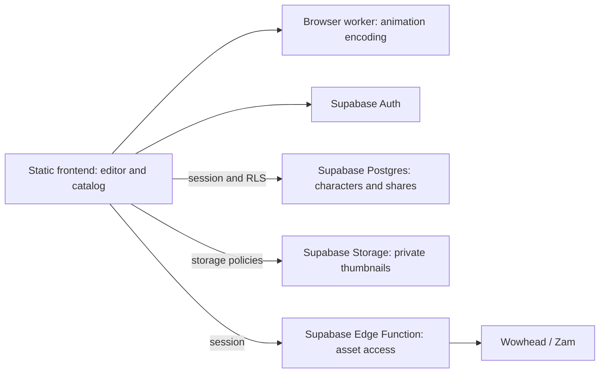

# Accounts, online characters and sharing

Planning only. No cloud services, authentication gate, database migrations or server changes have been implemented.

## Confirmed direction

- Require sign-in before the editor or a shared build can be used.
- Save character builds online, with autosave and **Save as copy**.
- Shared links always load the **latest saved version**.
- Signed-in recipients may save their own editable copy; they cannot edit the original.
- No existing server, domain or email provider. Prefer a free frontend plus Supabase, without a separate paid server.
- Use username/password with no email collection, no verification and no recovery. Forgotten passwords mean losing account access.

## Recommended free-only design to validate

Supabase can cover accounts, character data, private thumbnails and a small model-asset proxy. It cannot host the current Node/SQLite/Sharp/FFmpeg process unchanged. To avoid buying a server, move the catalog and animation work into the frontend and use small Edge Functions for the remaining network operations.

| Current local-server job               | Proposed replacement                                                                                                                 |
| -------------------------------------- | ------------------------------------------------------------------------------------------------------------------------------------ |
| Bootstrap/customization metadata       | A build-generated, versioned static snapshot                                                                                         |
| SQLite catalog searches and variations | Build-generated JSON chunks, loaded by category and searched in a browser worker; preserve aliases, filters, grouping and stable IDs |
| Viewer script                          | A compatible pinned static asset, with attribution and snapshot metadata                                                             |
| Model/texture downloads                | An allowlisted Supabase Edge Function streaming upstream files, with CORS and authenticated access                                   |
| Texture resizing                       | Native textures initially; investigate client-side resizing before promising the existing quality presets online                     |
| PNG composition                        | Already browser-side; retain outlines, glow, shadows and transparency                                                                |
| WebM/WebP encoding                     | A lazy-loaded browser worker, likely a single-thread WebAssembly encoder; prove alpha and performance first                          |
| Character persistence                  | Supabase Postgres with ownership policies and revision checks                                                                        |

This is an engineering proposal, not a tested deployment. First prove that the upstream host accepts requests from Supabase’s network and that both transparent animation formats can be encoded on the target browsers. If either fails, revisit the asset/encoder design before committing to a host. Preserve the existing local version while developing this path; do not quietly remove animated export from the online release.

Supabase’s hosted functions have 256 MB memory and 2 seconds of CPU time per request, with 150 seconds of wall time on Free. That suits a streaming fetch much better than animation encoding or Sharp. Cache public game assets in the browser rather than filling Supabase Storage with the Warcraft library. Inject the user session into asset request headers; do not put access tokens into model URLs. Test CORS, preflight, asset response types, response limits and revision compatibility with real models.

Sources: [Edge Function limits](https://supabase.com/docs/guides/functions/limits), [function CORS](https://supabase.com/docs/guides/functions/cors).

[ffmpeg.wasm](https://ffmpegwasm.netlify.app/docs/overview/) supports browser-side encoding and offers single- and multi-thread cores. Start by testing a single-thread core so hosting does not depend on cross-origin isolation headers. It is slower and consumes users’ device resources; [the project documents this tradeoff](https://ffmpegwasm.netlify.app/docs/faq/). Load the encoder only on export, bound frame count/memory, provide progress/cancel, and verify the existing transparent WebM/WebP output before choosing it. No encoder dependency has been added yet.

## GitHub Pages and account forms

The repository now has a Pages workflow and correct project-path handling. It is not yet an operational online editor. The current API configuration supports the existing server contract; the free-only design above needs additional implementation and will change how those calls are served.

[GitHub’s Pages guidance](https://docs.github.com/en/pages/getting-started-with-github-pages/github-pages-limits) discourages sensitive transactions such as sending passwords. Changing email to username does not change that guidance. Before public password signup, either choose a free frontend host suitable for account forms or design a separately hosted account flow with a reviewed session handoff. Google/Discord OAuth is another option that avoids collecting passwords on the Pages site and needs no confirmation-email provider. Keep this hosting/auth choice open until implementation; do not claim that direct-to-Supabase password requests resolve GitHub’s guidance.

## Supabase free tier

Checked on 13 November 2026:

| Resource        | Free allowance / behavior                                        |
| --------------- | ---------------------------------------------------------------- |
| Auth            | 50,000 monthly active users, rather than a lifetime-account cap  |
| Database        | 500 MB per project                                               |
| File storage    | 1 GB                                                             |
| Transfer        | 5 GB egress and 5 GB cached egress                               |
| Functions       | 500,000 invocations                                              |
| Projects        | Two active free projects                                         |
| Inactivity      | Can pause after a week of low activity; restore in the dashboard |
| Managed backups | Automatic backups are not included                               |

Character JSON is a good fit. Asset traffic and encoding are the main constraints for this app, rather than the headline login allowance. Measure bytes/requests for several representative player and NPC builds before estimating how many users the free plan supports. Download exports directly to users; do not store every animation. Store only small optional thumbnails and keep an independent backup/export process.

Sources: [Supabase pricing](https://supabase.com/pricing), [production availability](https://supabase.com/docs/guides/deployment/going-into-prod).

## Username/password without email

Supabase’s native password identity is an email address or phone number, not a username. It does support disabling email confirmation. A username UI is therefore a small custom identity mapping, not a built-in username switch. See [password authentication](https://supabase.com/docs/guides/auth/passwords) and [confirmation configuration](https://supabase.com/docs/guides/auth/general-configuration).

Proposed behavior:

1. A user chooses a unique, case-insensitive username and password. Normalize the handle, for example lowercase ASCII letters/numbers/underscore, 3–24 characters.
2. Internally map that immutable handle to an application-specific email-shaped identifier and use Supabase Auth for signup/login/password hashing. Verify the accepted identifier format in the initial prototype. No real email address is collected and no messages are sent.
3. Disable confirmation for this flow. Use a unique normalized handle and validate that profile creation matches the auth identity. Do not trust arbitrary user metadata to assign another user’s name or privileges.
4. Keep display names editable separately from login handles. Do not build a second password database or expose Auth admin credentials to the browser.
5. There is no password-reset or recovery-code feature, as requested. State this clearly at signup: losing the password means losing access. A signed-in password-change control can be added without introducing account recovery.

No email provider or sender domain is required for this selected flow. Supabase still handles password hashing and sessions. The absence of recovery is intentional; do not display a nonfunctional Forgot password option.

## Database proposal

| Table              | Fields                                                                                                                                                       | Purpose                                                                                    |
| ------------------ | ------------------------------------------------------------------------------------------------------------------------------------------------------------ | ------------------------------------------------------------------------------------------ |
| `auth.users`       | Supabase-managed identity and password records                                                                                                               | Account identity; no duplicate password storage                                            |
| `profiles`         | `id` → auth user, unique normalized `username`, `display_name`, `created_at`, `updated_at`                                                                   | Login handle and account display information                                               |
| `characters`       | UUID `id`, `owner_id`, `name`, `config` JSONB, `schema_version`, `asset_snapshot`, integer `revision`, nullable `thumbnail_path`, `created_at`, `updated_at` | Current saved build                                                                        |
| `character_shares` | `id`, `character_id`, `owner_id`, unique `token_hash`, `created_at`, nullable `revoked_at`/`expires_at`                                                      | Authenticated, revocable access to the character’s latest saved version; copying permitted |

Store stable race/NPC, appearance and equipment IDs, pose, framing, outline/glow, shadow and animation settings inside versioned configuration JSON. Keep ownership, name, revision and timestamps as queryable columns. The table’s name is canonical; assemble the full configuration for export/load.

Constrain names to 1–80 characters, JSON to an object and a reasonable size such as 200 KB, and revisions to positive integers. Index owner/update time, share character IDs and token hashes. Database logic controls timestamps/revision increments and enforces matching character/share ownership. Account deletion removes owned characters/shares; clean up thumbnail objects separately. Character deletion revokes its links.

Keep catalog data out of the user database. A snapshot identifier is useful for validation, but exact historical appearance also requires compatible retained assets. Detect incompatible IDs clearly rather than silently loading another appearance.

## Permissions and sharing

Enable Row Level Security on every exposed table. Owners alone can create/read/update/delete their character rows and manage their shares. Anonymous access and unrelated signed-in accounts get no access. Recipients never receive update rights to the original. See [Supabase RLS](https://supabase.com/docs/guides/database/postgres/row-level-security).

A share URL can be `https://lolfrad.github.io/dnd-wow-campaign-charactercreator/#/share/<random-token>`. After sign-in, a narrow authenticated RPC/Edge Function hashes the token, checks revocation/expiry and returns the latest saved configuration. Links stay short; the configuration does not need to be embedded in the URL. Do not make share rows enumerable. Elevated RPCs need a locked search path and explicit authorization checks, not reliance on table RLS alone.

Anyone with the link and an account can view it and save a new copy owned by them. A link is not a named-person invitation. Copying assigns a new UUID and owner; future edits to either copy are independent. Revocation prevents later access but cannot recall already downloaded configurations/images.

Optional thumbnails use a private bucket, ownership policies and short-lived signed URLs. Shared access grants only the permitted thumbnail. Never put service-role keys into frontend variables. Test owner A, unrelated account B, anonymous requests, valid links and revoked links.

## Login, online saving and top-bar behavior

Show sign-in/create-account before initializing the editor. After authentication, open **My characters**, a new build or the pending shared link. Restore sessions on return. If a session expires during editing, retain changes in memory and pause saving until the user signs in again.

The database is the source of truth; do not keep a localStorage character library. Browser memory holds the working document. Sessions and disposable public asset/thumbnail caches may remain local. Offer an explicit import for old browser drafts/JSON, never silently upload them into whichever account logs in.

Autosave after 1–2 seconds of idle time and coalesce slider drags. Serialize writes; show **Saved** only after acknowledgment, otherwise **Saving…**, **Unsaved changes** or **Could not save · Retry**. Flush before switching builds/signing out and warn before leaving with unsaved changes. Do not rely on a page-close upload.

Each write must match the last known revision. On a tab/device conflict, preserve the working copy and offer **Reload saved version** or **Save as copy**. Ignore stale responses so an older request cannot replace a newer edit.

The top bar should contain the editable name, save status, **New**, **My characters**, **Save as copy**, **Share**, **Export** and account menu. The current implementation has name/New/Load JSON/Save JSON/Export; cloud actions replace browser-draft persistence when the real integration is added. Shared views are read-only except for saving a personal copy.

## What to prepare now

1. Create one free Supabase project, preferably in the desired EU region. Retain its URL and publishable key. Do not share/embed the service-role key or database password.
2. Keep Pages configured to **GitHub Actions** for the prepared frontend workflow. Do not purchase a server, domain or SMTP service for the proposed no-email design.
3. Settle the password-form hosting decision above. The selected flow is username/password without verification or recovery; changing the identifier does not remove the Pages password-form guidance.
4. Start with a small private group and measure asset bandwidth/function usage. Decide an initial character limit; defer folders, public galleries and collaborative editing.

## Next implementation sequence

1. Prototype Supabase asset access and browser WebM/WebP encoding first. Validate real upstream access, transparency, memory and speed before committing to the free-only architecture.
2. Generate static bootstrap/catalog chunks and port catalog querying/asset loading. Keep the local Node workflow working.
3. Create migrations, RLS, live-link resolution and cross-account permission tests.
4. Add username/password login/signup with the agreed no-recovery behavior and gate editor access on real sessions.
5. Replace local draft persistence with the cloud library, autosave/revision handling, Save as copy and explicit legacy import.
6. Add private thumbnails and share/revoke controls. Test two accounts, interrupted saves, expired sessions and backups on the deployed frontend.
