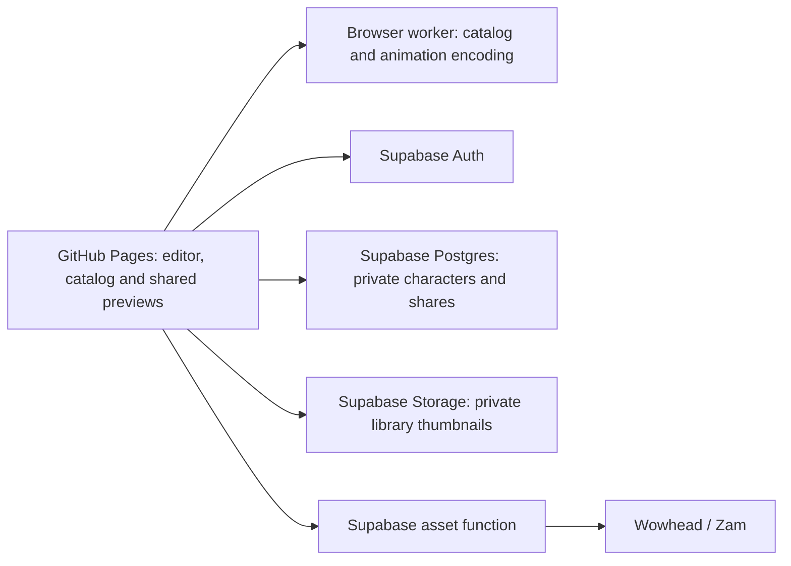

# Cloud accounts and character storage

The Supabase integration is implemented for the Pages build. The local Node workflow remains available separately.

## Current behavior

- Username/password signup and login, with no email collection or verification.
- No password recovery, as requested. The signup form explains that a forgotten password means losing account access.
- Sign-in before initializing the cloud editor or opening a shared character.
- My characters appears after every login and page load. Select a saved build or the New character tile; Duplicate beside Delete opens an independent copy. Online edits autosave, with no JSON or copy controls in the top bar.
- Shared links load the latest saved version when opened. Recipients must sign in and may save an independent copy.
- Supabase stores character JSON and small private thumbnails. Character builds are not saved in localStorage in cloud mode; only the login session and disposable preview caches are stored in the browser.

## Architecture

There is no separately hosted Node/SQLite/FFmpeg server in the Pages path. Build-time scripts generate the catalog from the checked-in SQLite snapshot. The browser searches it in a worker. A small authenticated Edge Function loads allowlisted game assets. Another function creates username-based accounts, using Supabase Auth for passwords and sessions.

Animated WebP and transparent VP8 WebM are encoded in a lazy-loaded, single-thread browser worker. Rendering, encoding and memory use are paid by the user's device rather than a server. Normal local exports retain the native encoder. The cloud asset function serves native textures; low/medium server resizing is part of the local workflow.

## Database and access

| Table                   | Contents                                                                                        | Access                                                           |
| ----------------------- | ----------------------------------------------------------------------------------------------- | ---------------------------------------------------------------- |
| `auth.users`            | Supabase identities and password hashes                                                         | Managed by Supabase Auth                                         |
| `profiles`              | User ID, unique normalized username, creation time                                              | Owner reads their profile                                        |
| `characters`            | Owner, name, versioned configuration JSON, asset snapshot, revision, thumbnail path, timestamps | Owner reads/deletes; controlled RPC creates/updates              |
| `character_shares`      | Character/owner IDs, hash of a random token, timestamps                                         | Owner lists/revokes; authenticated RPC resolves a specific token |
| `private.signup_limits` | Short-lived hashes and signup counts                                                            | Signup service only; no client access                            |

All application tables have Row Level Security. Character writes go through a narrow ownership-checked function and use a revision number. A stale write returns HTTP 409; the editor retains unsaved changes and offers saving a copy or loading the current document. There is a 200-character-per-account limit and a 200 KB configuration limit.

Share tokens contain 256 bits of randomness; only their hashes are stored. URLs use `#/share/<token>`, which works under a GitHub Pages project path. A link grants read access to the latest saved document, not update rights. Copying creates a new UUID under the recipient's ownership. There are at most 20 active links per character. Revoking a link or deleting the original removes future access; downloaded copies cannot be recalled.

The private `character-thumbnails` bucket accepts WebP files up to 128 KiB. The app captures library previews separately at export resolution and generates 512-pixel WebP thumbnails, writes one file per saved character and uses short-lived signed URLs for the owner's library. Opening a character refreshes its older thumbnail. Thumbnails are optional: a failed thumbnail upload does not invalidate a saved character.

## Accounts without email

The UI normalizes usernames to 3–24 lowercase letters, digits or underscores. Internally it maps them to application-specific email-shaped identifiers under `users.tokenforge.invalid`. These are not real addresses and no email is sent. Signup is handled by the `accounts` function, which creates a confirmed Supabase Auth identity; no SMTP or email-confirmation setting is needed.

The service-role key stays inside Supabase's function environment. The app contains only the public project URL and publishable client key. Signup attempts are limited by a short-lived keyed address hash; raw addresses and passwords are not stored in application tables or logged by the functions.

The existing GitHub Pages guidance discourages password-handling sites. The requested Pages integration is implemented, but changing email to username does not remove that guidance. Review hosting suitability before expanding beyond a small hobby group. [GitHub Pages limits](https://docs.github.com/en/pages/getting-started-with-github-pages/github-pages-limits)

## Preview caching and free-tier storage

The shared preview images belong on Pages, not in Postgres. The repository contains about 45 MiB of PNG previews; the Pages build converts them to WebP and writes actual sizes to `preview-storage.json`. `scripts/optimize-previews.mjs` changes only generated build files, preserving original images and exported PNG tokens.

A static preview request goes to Pages and never invokes Supabase. Reference previews are reused across users; previews generated on demand are cached by snapshot/configuration in IndexedDB. Game assets use canonical URLs, private HTTP caching and a cached CORS preflight, so repeated views can reuse browser downloads. Supabase is contacted when a model asset is not cached, rather than for every displayed thumbnail.

Supabase Free currently separates **500 MB database storage** from **1 GB file Storage**. It also limits transfer and function invocations, and can pause inactive projects. Public previews do not need to consume either Supabase storage quota. Put only character configurations in Postgres and small private library thumbnails in Storage. Do not save exported animations or the whole game asset library there. [Supabase billing](https://supabase.com/docs/guides/platform/billing-on-supabase)

The asset function does not maintain a permanent server-side texture cache. Full-catalog pre-rendering can be added as trusted batches on Pages. Budget using the actual encoded average and the number of variants/poses; do not assume every possible customization combination can be pre-rendered.

## Verification and maintenance

Unit tests cover catalog parity, ID aliases, autosave ordering/retry/conflicts and asset authorization/path rules. Live checks with two temporary users verify account isolation, revision conflicts, current-version sharing, copy/revocation and private thumbnails. Browser checks cover the real model connection and transparent animation encoding.

Authenticated SECURITY DEFINER RPCs are intentional: each locks its search path and enforces ownership/token access, while direct client writes are denied. The private signup-limit table intentionally has no client policies. Supabase's advisor may flag both patterns for review. [Function advisory](https://supabase.com/docs/guides/database/database-linter?lint=0029_authenticated_security_definer_function_executable), [default-deny table advisory](https://supabase.com/docs/guides/database/database-linter?lint=0008_rls_enabled_no_policy). Free does not include leaked-password protection; [Supabase password controls](https://supabase.com/docs/guides/auth/password-security#password-strength-and-leaked-password-protection).

The game snapshot is pinned. A changed viewer hash is rejected rather than silently mixed with old metadata. Updating game data requires refreshing bootstrap/catalog data and the function's snapshot policy together. Back up the user database separately; the free plan is not a backup service.
